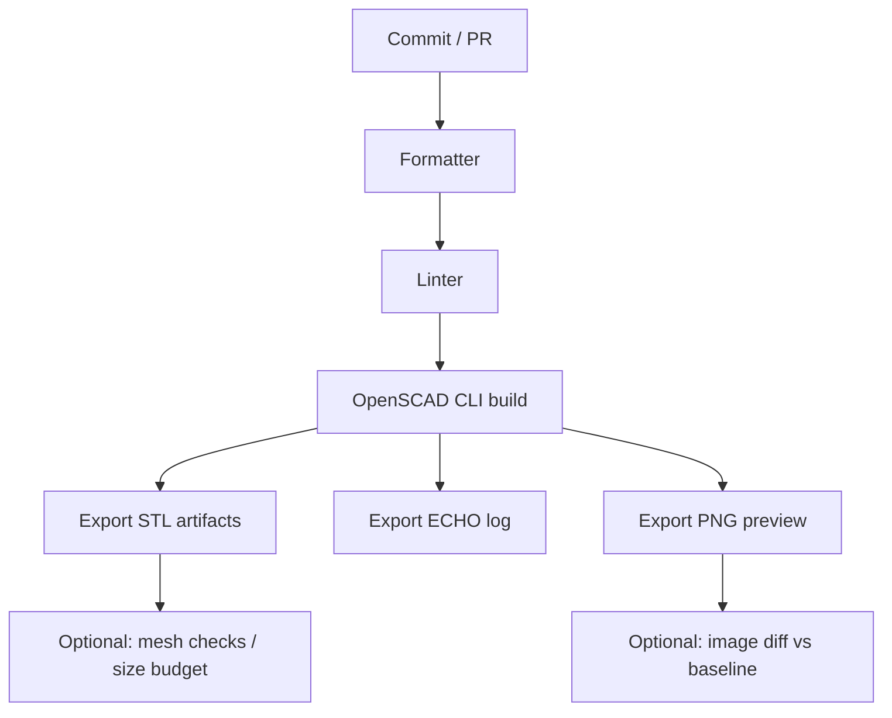

# Детальный обзор и предложения по улучшению файла helical_antenna_dev_v11.scad

## Executive summary

Файл — рабочий параметрический генератор корпуса/направляющей под спиральную антенну (по сути: цилиндрический «боди» с винтовой канавкой, секционированием и внутренним стыковочным кольцом). В текущем виде он уже полезен, но есть несколько мест, которые прямо влияют на корректность геометрии и удобство экспорта: дробное число “steps” в генерации спирали может обрывать канавку до верхней точки, режимы экспорта “single/sequence” фактически не решают задачу «подготовить детали к печати» (смещение по Z для секций), а вычисляемые параметры, вероятно, засоряют Customizer, потому что идут до первого `{` без секции `[Hidden]`. С точки зрения производительности главная «тяжёлая» часть — цикл `hull()` на каждой паре точек; её можно радикально упростить через `linear_extrude(... twist=...)`, что в OpenSCAD обычно даёт сопоставимый результат при меньшей стоимости. Для промышленного качества: добавить валидацию параметров через `assert()`, явные единицы измерения, опциональный “handedness”, зазор/посадку для стыковочного кольца и минимальный CI со сборкой STL/PNG/ECHO через CLI и набором JSON-параметров. citeturn6view2turn6view0turn5search0turn10view1turn2search5

## Обзор файла и ключевые допущения

Формат файла — скрипт для entity["organization","OpenSCAD","3d cad script tool"] (расширение `.scad`), то есть декларативное описание 3D-геометрии через CSG-операции и параметры. Общая структура типична: блок “Customizer-параметров” сверху, затем вычисление производных величин (частота → длина волны → геометрия спирали → толщина стенки → секции), далее модули геометрии (`full_helix()`, `body_section(i)`), и в конце — ветка рендера по `export_mode`. Документация по структуре языка и подходу “модули/функции” есть в официальных материалах и мануале. citeturn4search3turn2search9turn2search15turn4search9

Внутри файла реализована «классическая» осевая (axial-mode) эвристика для спиральной антенны: окружность витка около одной длины волны и шаг порядка четверти длины волны (в коде используются близкие коэффициенты). Эти ориентиры широко встречаются в справочной литературе и обзорах по axial-mode helix; важно явно закрепить, что это именно приближённая инженерная модель, а не результат ЭМ‑симуляции или оптимизации под конкретный диэлектрик/корпус/провод. citeturn1search1turn1search0turn1search20turn1search12

В расчёте длины волны используется константа `300000 / f_MHz`, т.е. скорость света, округлённая до 300 000 км/с. Если цель — аккуратность, можно перейти на точное значение скорости света (299 792 458 м/с), опубликованное entity["organization","NIST","us standards institute"] как точная константа СИ. Практически это небольшая разница, но она бесплатна и улучшает доверие к расчёту. citeturn1search7turn1search31

image_group{"layout":"carousel","aspect_ratio":"16:9","query":["axial mode helical antenna geometry circumference wavelength spacing quarter wavelength diagram","3d printed helical antenna former with groove OpenSCAD"],"num_per_query":1}

## Найденные проблемы

Ниже — проблемы, сгруппированные по приоритету (критично/высокий/средний/низкий). Где возможно, я привожу короткие фрагменты вашего кода как “улику” (чтобы не гадать, а показать пальцем).

### Таблица проблем

| ID | Приоритет | Симптом/риск | Где видно в коде | Почему это важно | Коротко как чинить |
|---|---|---|---|---|---|
| P1 | **Критично** | Спиральная канавка может не доходить до верхней точки (обрыв), особенно при `turns` нецелом | `steps = turns * (...)` и `for (i=[0:steps-1])` + деление на `steps` | Если end диапазона дробный, цикл остановится на `floor(steps-1)`, и последний сегмент даст `z2 < height` → канавка заканчивается раньше | Принудительно сделать `steps` целым (`ceil/round`) и/или строить по целому “slices” |
| P2 | **Высокий** | Экспорт секций “single/sequence” не укладывает деталь в ноль по Z: секция `i>0` экспортируется «в воздухе» (смещена вверх) | `module body_section(i)` режет по `z0=i*section_height`, но `export_mode=="single"` просто вызывает `body_section(export_section)` | Для печати/слайсера детали обычно ожидаются на Z=0; смещённые модели повышают шанс ошибок/неудобства | Добавить «обёртку экспорта» `translate([0,0,-z0])` только в экспортных режимах |
| P3 | **Высокий** | Режим `sequence` сейчас делает то же, что `single` (функционально не реализован) | `else if (export_mode == "sequence") { body_section(export_section); }` | Пользователь выбирает режим, но получает тот же результат — это «меню без кухни» | Реализовать раскладку всех секций в ряд/сетку для печати |
| P4 | **Высокий** | Производные переменные, вероятно, попадают в Customizer и засоряют UI | Все вычисления (`frequency`, `lambda`, `turns`, …) идут до первого `{` и без `/* [Hidden] */` | В Customizer показываются присваивания до первого `{` и вне “Hidden”; это быстро делает панель непригодной citeturn6view2 | Вставить `/* [Hidden] */` перед вычисляемыми параметрами (или поставить “Customizer limit” модуль) |
| P5 | **Высокий** | Нет жёсткой валидации параметров (частота ≤ 0, стенка ≤ 0, `max_section_height` ≤ 0 и т.п.) | Нет `assert()` | На «плохих» входах OpenSCAD может молча генерировать мусор/пустоту, а в CI это превращается в плавающие баги | Добавить `assert(condition, message)` для ключевых инвариантов citeturn5search0turn5search4 |
| P6 | **Средний** | Стоимость `hull()` в цикле масштабируется хуже, чем нужно | `hull() { sphere(); sphere(); }` внутри `for` | `hull`/сложные булевы операции — одна из самых дорогих категорий в OpenSCAD; на больших моделях это съедает время citeturn2search23turn2search5 | Перейти на `linear_extrude(... twist=...)` для “helix tube” или хотя бы уменьшить количество `hull` |
| P7 | **Средний** | Глобальный `$fn` фиксированный (24/48) может переусложнять мелкие элементы | `$fn = render_quality == ... ? 24 : 48;` | Документация подчёркивает роль `$fa/$fs/$fn`; глобальный `$fn` часто делает маленькие окружности слишком “тяжёлыми” citeturn4search4turn4search9turn2search5 | Использовать `$fa/$fs` или локальный `$fn` на конкретных примитивах |
| P8 | **Средний** | “Магические числа” без объяснения (например, `-0.2`, коэффициенты 0.55, 0.015) | `groove_radius = ... - 0.2`, `groove_depth=wire_d*0.55`, `wave_wall=lambda*0.015` | Без явной причины это трудно поддерживать и корректировать под печать/материал/допуски | Вынести в именованные параметры (с комментарием «почему так») |
| P9 | **Средний** | Стыковочное кольцо без явного зазора посадки | `ring_outer = inner_radius; ring_inner = inner_radius - wall;` | Для печати нужен технологический зазор; “в ноль” почти всегда клинит | Добавить `fit_clearance` и конусный ввод (taper) |
| P10 | **Низкий** | Константа скорости света округлена; нет указания единиц | `lambda = 300000 / frequency;` | Это не “фатальный” баг, но улучшение качества/доверия | Использовать 299792.458 и подписать `_mhz/_mm` citeturn1search7 |
| P11 | **Низкий** | В шапке файла есть персональные данные (email) | Комментарий в заголовке | Для публичного репозитория/шеринга это риск приватности | Либо убрать, либо заменить на “contact via repo issues”, либо вынести в README |
| P12 | **Низкий** | В файле нет явной лицензии | Нет SPDX/License block | Без лицензии юридически “все права защищены” → пользователям нельзя нормально использовать/форкать | Добавить SPDX в шапку + LICENSE в репо |

### Ключевые фрагменты, на которых “держатся” критичные/высокие проблемы

Проблема P1 (дробные steps → недоход спирали до вершины) в текущей реализации выглядит так:

```scad
steps = turns * (render_quality == "Быстрый" ? 10 : 20);

for (i = [0:steps-1]) {
    z1 = height * i/steps;
    z2 = height * (i+1)/steps;
    ...
}
```

Если `turns` не целое (а в вашем расчёте оно вполне может быть нецелым), `steps` становится дробным, диапазон `[0:steps-1]` заканчивается на `floor(steps-1)`, и последняя итерация даёт `z2 < height`. Результат: канавка (или её последняя “капсула”) обрывается чуть ниже верхней точки; визуально это может выглядеть как «недокрут» последнего витка.

Проблемы P2–P3 (экспорт/sequence) сейчас фактически:

```scad
if (export_mode == "preview") {
    for (i = [0:section_count-1])
        body_section(i);
}
else if (export_mode == "single") {
    body_section(export_section);
}
else if (export_mode == "sequence") {
    body_section(export_section);
}
```

Без дополнительного `translate([0,0,-z0])` секция с индексом >0 остаётся на высоте своей сборочной позиции.

## Конкретные предложения по улучшению с патчами и командами

Ниже — набор изменений, которые можно вносить независимо. Я намеренно даю “патчи” как готовые куски, чтобы вы могли копировать/вставлять без археологии.

### Исправление целочисленного steps и гарантированного замыкания по высоте

**Цель:** гарантировать, что последняя итерация даёт `z2 == height`.

**Минимальный патч:**

```scad
// Было:
steps = turns * (render_quality == "Быстрый" ? 10 : 20);

// Стало:
steps = ceil(turns * (render_quality == "Быстрый" ? 10 : 20));
```

Если вы хотите чуть стабильнее (и избегать “скачков” при изменении `turns` на сотые), можно использовать `round()` вместо `ceil()`, но для геометрии “лучше лишний сегмент, чем недосегмент”.

### Переосмысление helix: заменить цикл hull() на linear_extrude(twist)

Это потенциально самый жирный выигрыш по производительности/простоте, потому что вы убираете сотни `hull()`.

Согласно документации, `linear_extrude()` поддерживает `twist` (в градусах) и `slices` для уточнения меша. Twist считается в градусах; `twist=360` — один оборот. Также указано, что направление twist следует “left hand rule”. citeturn10view1turn10view2turn9search0

**Новый модуль helix-трубы (замена `full_helix()`):**

```scad
// Настройка: число срезов (чем больше, тем плавнее и тяжелее)
helix_slices =
    render_quality == "Быстрый" ?  max(60, ceil(turns * 20))
                                :  max(120, ceil(turns * 40));

// Явный выбор направления (прав/лев спираль)
handedness = "RH"; // [RH, LH]  // необходимо предоставить: хотите ли вы это в Customizer?

module full_helix() {
    groove_radius = body_radius + groove_depth - groove_overlap; // см. ниже
    twist_deg = turns * 360 * (handedness == "RH" ? -1 : 1); // из-за left hand rule в linear_extrude()

    linear_extrude(height = height,
                   twist = twist_deg,
                   slices = helix_slices,
                   convexity = 10)
        translate([groove_radius, 0, 0])
            circle(d = groove_d, $fn = groove_fn);
}
```

Дополнительно (чтобы убрать “магическое -0.2” и сделать это параметром печатного перекрытия):

```scad
groove_overlap = 0.2;   // мм: насколько канавка должна "заходить" в тело
groove_fn      = 12;    // локальная детализация круга канавки
```

**Почему это работает:** круг, смещённый от центра на `groove_radius`, при `linear_extrude(height, twist)` описывает винтовую траекторию вокруг оси Z и получается “труба” по винтовой линии, которую вы вычитаете из корпуса так же, как сейчас. Параметр `slices` именно для такого “twisted geometry” и предназначен. citeturn10view2turn10view1turn2search5

### Исправление экспорта секций: “сборка” vs “деталь для печати”

Сейчас `body_section(i)` генерирует секцию “на месте” сборки. Для печати логичнее иметь отдельный экспортный вызов, который кладёт секцию на Z=0.

**Патч-обёртка:**

```scad
module body_section_assembly(i) {
    body_section(i); // как сейчас
}

module body_section_print(i) {
    z0 = i * section_height;
    translate([0,0,-z0]) body_section(i);
}
```

И заменить блок рендера:

```scad
if (export_mode == "preview") {
    for (i = [0:section_count-1])
        body_section_assembly(i);
}
else if (export_mode == "single") {
    body_section_print(export_section);
}
else if (export_mode == "sequence") {
    // раскладка всех секций в ряд
    gap = 5;
    pitch_x = 2 * body_radius + gap;
    for (i = [0:section_count-1])
        translate([pitch_x * i, 0, 0])
            body_section_print(i);
}
```

Теперь:
- preview показывает “собранную” конструкцию,
- single экспортирует выбранную секцию на плоскости,
- sequence раскладывает все секции для партии печати.

### Убрать “мусор” из Customizer: добавить Hidden перед вычислениями

Customizer показывает переменные, удовлетворяющие условиям (включая “присвоено в main file”, “до первого `{`”, “не в [Hidden]”). В документации явно описано, что `/* [Hidden] */` — современная best practice для скрытия непубличных переменных. citeturn6view2turn8view0

**Патч:**

Сразу после последнего пользовательского параметра Customizer (после `$fn` или после блока “Качество рендера”) вставьте:

```scad
/* [Hidden] */
```

И ниже уже держите все вычисляемые переменные: `frequency`, `lambda`, `turns`, `radius`, `wire_length`, `auto_wall`, и т.п.

### Валидация параметров через assert()

OpenSCAD поддерживает `assert(condition, message)` как в модуле, так и в выражениях. citeturn5search0turn5search4

**Рекомендуемый набор assert-инвариантов (минимальный):**

```scad
assert(frequency > 0, "frequency must be > 0 MHz");
assert(manual_frequency > 0, "manual_frequency must be > 0 MHz");
assert(max_section_height > 0, "max_section_height must be > 0");
assert(wall > 0, "wall must be > 0");
assert(radius > 0, "radius must be > 0");
assert(groove_d > 0, "groove_d must be > 0");
assert(section_count >= 1, "section_count must be >= 1");
assert(export_section >= 0 && export_section < section_count,
       str("export_section out of range: ", export_section));
```

Где `str()` — стандартная строковая функция склейки. citeturn5search5

### Улучшение UI/логики выбора диапазона частот (убрать длинную цепочку тернарников)

Customizer поддерживает выпадающие списки **для чисел** и **для строк**, включая пометки “labeled values”. citeturn6view2turn0search0

Сейчас вы храните `band` строкой и мапите её на число через цепочку `band == "350" ? 350 : ...`. Это читается, но плохо масштабируется.

**Вариант A (числовой band + sentinel для ручного ввода):**

```scad
band = 1200; // [0:Manual, 350:350, 450:450, 550:550, 650:650, 750:750, 850:850, 950:950, 1050:1050, 1200:1200, 1400:1400, 1600:1600, 1800:1800, 2000:2000, 2200:2200, 2400:2400, 2600:2600, 2800:2800]
manual_frequency = 1200;

frequency = (band == 0) ? manual_frequency : band;
```

**Риск:** если кто-то выставит `band=0` и забудет `manual_frequency`, будет `assert`-ошибка (и это хорошо).

**Вариант B (сохранить строковый band, но вынести маппинг в таблицу):**

OpenSCAD имеет средства работы со списками и функциями (включая `search`, `lookup` и т.п.), но это уже чуть более “функциональный стиль”. Если хотите оставить максимально совместимо и просто — вариант A обычно лучшая сделка.

### Посадка стыковочного кольца: добавить технологический зазор и ввод

Сейчас:

```scad
ring_outer = inner_radius;
ring_inner = inner_radius - wall;
```

Для печати “в ноль” почти всегда больно, поэтому лучше сделать:

```scad
fit_clearance = 0.25; // мм, необходимо предоставить: под ваш принтер/пластик
lead_in = 0.8;        // мм конусный ввод

ring_outer = inner_radius - fit_clearance;
ring_inner = ring_outer - wall;

// Внутреннее кольцо: добавить небольшой конус на входе
module inner_ring(z_at) {
    difference() {
        translate([0,0,z_at])
            cylinder(h = ring_length, r = ring_outer);
        translate([0,0,z_at - 1])
            cylinder(h = ring_length + 2, r = ring_inner);

        // конусная фаска/ввод (очень грубо, но помогает сборке)
        translate([0,0,z_at])
            cylinder(h = lead_in, r1 = ring_outer, r2 = ring_outer - lead_in);
    }
}
```

**Почему важно:** без зазора и ввода вы получите либо “не лезет”, либо “лезет только молотком (а потом не вылезет)”.

### Документация и лицензирование

1) Явно обозначьте “что это”: генератор формы для намотки/укладки провода, а не “готовая антенна” в смысле ЭМ‑характеристик.

2) Добавьте README с:
- единицами (MHz, mm),
- границами применимости формул (axial-mode),
- советами по печати (зазоры, ориентация, поддержку),
- примером запуска CLI.

3) Добавьте лицензию. Без лицензии по умолчанию получаются “все права защищены”, что мешает даже добросовестным пользователям и вашим же будущим коллабораторам.

## Рекомендации по тестам, CI/CD, статическому анализу и инструментам

### Минимальный набор “тестов” для OpenSCAD-проекта

OpenSCAD — не та среда, где unit‑тесты делаются как в Python/Go, но automatisation через CLI — нормальная практика: экспортируете STL/PNG/ECHO и проверяете, что:
- сборка не падает,
- `echo()` выводит ожидаемые производные значения,
- STL создаётся,
- PNG-рендер похож на эталонный (опционально).

CLI поддерживает экспорт через `-o`, в том числе `echo` и `png`, а также параметр-сеты `-p`/`-P` (JSON). citeturn6view0turn6view1turn6view3turn8view0

**Пример команд (локально):**

```bash
# 1) Собрать STL (явно бинарный STL, если нужно)
openscad -o out.stl --export-format binstl helical_antenna_dev_v11.scad

# 2) Снять лог вычислений и echo() в файл
openscad -o out.echo helical_antenna_dev_v11.scad

# 3) PNG для визуальной регрессии (preview или render)
openscad -o out.png --imgsize=1200,800 --viewall helical_antenna_dev_v11.scad
openscad -o out_render.png --imgsize=1200,800 --viewall --render helical_antenna_dev_v11.scad

# 4) Сборка по JSON-набору параметров Customizer
openscad -o out_1200mhz.stl -p parameterSets.json -P "1200MHz_default" helical_antenna_dev_v11.scad
```

Пояснения:
- Вариант `--export-format` описан в CLI-справке (включая `asciistl` vs `binstl`). citeturn6view0turn6view1turn6view4  
- Формат JSON параметров и использование `-p`/`-P` описаны в мануале Customizer. citeturn8view0turn8view1

Отдельно: документация отмечает, что GUI по умолчанию экспортирует **binary STL**, а CLI долгое время по умолчанию делал **ASCII STL**, поэтому лучше явно задавать формат для повторяемости. citeturn6view1turn3search3

### Инструменты: форматирование, линтинг, IDE

Ниже — практичный набор, который реально можно включить в CI и pre-commit.

| Категория | Инструмент | Плюсы | Минусы/риски | Когда брать |
|---|---|---|---|---|
| Форматтер | `openscad-format` (npm) | Есть CLI, поддерживает конфиг, умеет “force overwrite”, даже генерит doc-комменты | Лицензия GPL‑3.0; в некоторых компаниях это красный флаг | Если проект опенсорсный или GPL‑совместим и хочется управляемого форматирования citeturn7view0 |
| Форматтер | SCADFormat | Простая установка бинарником; “opinionated” форматирование | Мало настроек (по заявлению проекта) | Если хотите единый стиль “без споров” citeturn7view1 |
| Линтер | SCA2D (PyPI) | Цель — корректный лексинг и поиск ошибок/стиля; проверяет scope, include/use и т.п. | Может иметь несовместимости с “нестандартными” конвенциями | Если важна дисциплина кода и рост проекта citeturn7view2 |
| Линтер | openscad-linter | Очень простой старт | “Rudimentary”, небольшой проект | Если нужен лёгкий sanity-check в CI citeturn7view3 |
| IDE/LSP | openscad-LSP / openscad-language-server | Автодополнение, jump to definition, диагностика | Нужно ставить Rust toolchain | Если вы живёте в VS Code/Neovim/Emacs и хотите комфорт разработки citeturn3search2turn3search6 |

### CI/CD: варианты реализации

| Вариант CI | Как устроен | Плюсы | Минусы | Рекомендация |
|---|---|---|---|---|
| Готовый action “build OpenSCAD project” | GitHub Marketplace action, который запускает OpenSCAD CLI и сохраняет артефакты | Быстро внедряется, меньше инфраструктуры | Зависимость от стороннего action | Отлично как старт, пока не нужна тонкая настройка citeturn3search7turn7view4 |
| Свой workflow + docker/установка openscad | В workflow ставите OpenSCAD и гоняете `openscad -o ...` | Полный контроль, легко расширять тестами/диффами | Чуть больше времени на настройку | Лучший вариант для зрелого проекта (особенно если важна воспроизводимость) citeturn6view0turn6view4 |

### Mermaid-диаграмма для CI пайплайна



## Шаги по внедрению улучшений с оценкой трудозатрат и рисков

Оценки — в человеко‑часах, для разработчика, который уже ориентируется в OpenSCAD. Если вы хотите “под ключ + CI + регрессии”, закладывайте верхнюю границу.

| Шаг | Что делаем | Трудозатраты | Риск | Комментарий |
|---|---|---:|---|---|
| 1 | Добавить `/* [Hidden] */` перед вычисляемыми переменными | 0.3–0.7 | Низкий | Быстро улучшит UX Customizer citeturn6view2 |
| 2 | Исправить `steps` на целое + sanity-check визуально | 0.5–1.5 | Низкий | Это точечный фикс, но влияет на геометрию (и это хорошо) |
| 3 | Разделить сборку/экспорт: `body_section_assembly` + `body_section_print`, реализовать `sequence` раскладкой | 1.5–3.5 | Средний | Нужно аккуратно, чтобы preview остался прежним |
| 4 | Добавить `assert()` на критические параметры | 1–2 | Низкий | Поведение станет “шумнее” на плохих входах, зато предсказуемее citeturn5search0 |
| 5 | Вынести “магические числа” в параметры (overlap, clearance, коэффициенты) + комментарии | 1–3 | Низкий | Улучшение сопровождения |
| 6 | Перевести генерацию helix на `linear_extrude(twist)` (опционально с флагом `helix_impl`) | 3–7 | Средний/Высокий | Нужна проверка идентичности канавки и отсутствия артефактов; но выигрыш по скорости может быть большим citeturn10view1turn10view2 |
| 7 | Добавить посадочный зазор стыковочного кольца + ввод | 2–5 | Средний | Потребуется калибровка под ваш принтер/материал (**необходимо предоставить**: реальный допуск) |
| 8 | Поднять минимальный CI: экспорт STL+ECHO+PNG для 2–3 параметр‑сетов | 2–6 | Средний | Потребуется подобрать окружение runner’а и стабильные параметры камеры citeturn6view0turn8view0 |
| 9 | Подключить форматтер/линтер + pre-commit | 1–4 | Низкий | Выбор инструмента зависит от лицензии/стека citeturn7view0turn7view2 |

### Mermaid-диаграмма архитектуры генерации

```mermaid
flowchart LR
  P[Customizer параметры] --> C[Расчёт производных величин]
  C --> H[Геометрия винтовой канавки]
  C --> B[Геометрия корпуса]
  C --> S[Секции и стыковочное кольцо]
  H --> M[body_section(i)]
  B --> M
  S --> M
  M --> R{export_mode}
  R -->|preview| A[Сборка всех секций]
  R -->|single| X[Одна секция на Z=0]
  R -->|sequence| Y[Все секции разложены для печати]
```

## Артефакты, которые нужно предоставить для более точного анализа

Вы файл предоставили, поэтому базовый разбор возможен. Но чтобы дать **по-настоящему точные** рекомендации (особенно по механике стыка, допускам и “правильной” канавке под провод), нужны дополнительные входные данные. Ниже — список “необходимо предоставить” (с примерами содержимого), чтобы анализ стал инженерным, а не “по фотографии”:

1) **Цель изделия** (1–2 абзаца).
   - Пример: “Это оправка/держатель для намотки провода, антенна используется с металлической землёй X мм”.

2) **Материал и технология печати** (**необходимо предоставить**).
   - PLA/PETG/ABS, высота слоя, сопло, усадка, желаемая посадка (скользящая/плотная/на клей).

3) **Требования к сборке секций** (**необходимо предоставить**).
   - Нужно ли защёлкивание, винты, клей, допуск на перекос.
   - Фото/эскиз соединения (даже от руки).

4) **Реальный провод/трубка и допуски канавки** (**необходимо предоставить**).
   - Диаметр провода, изоляция, жёсткость, нужно ли “вдавливать” или “укладывать”.

5) **Набор эталонных конфигураций Customizer** (JSON parameter sets).
   - Можно сохранить через Customizer и приложить `parameters.json`; формат и CLI-использование описаны в мануале. citeturn8view0turn6view0

6) **Ожидаемый формат экспорта и сценарий использования**.
   - “GUI-only”, “CLI batch export”, “репозиторий на GitHub + CI артефакты” (если да — какие именно артефакты нужны: STL/3MF/PNG/ECHO).

7) **Лицензирование и модель распространения** (**необходимо предоставить**).
   - Private/Commercial/Open Source; от этого зависит выбор форматтера/линтера (в т.ч. по лицензиям инструментов).